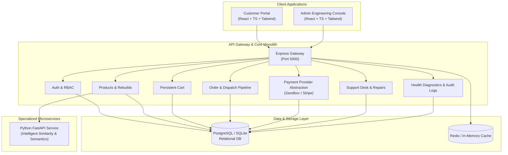

# SecondLife — System Architecture & Engineering Blueprint

## 1. Executive Summary & Philosophy
SecondLife is a modular full-stack e-commerce platform dedicated to circular hardware: **rebuilt, reused, restored, recycled, and creatively repurposed electronics**.

The architecture follows a **Modular Monolith First** pattern with decoupled boundaries, allowing individual capabilities (e.g. AI Recommendations, heavy order batching) to be cleanly extracted as independent microservices.

---

## 2. Layer Responsibilities

### Frontend Layer (`frontend/`)
- **Technology**: React 18, TypeScript, Tailwind CSS, Lucide Icons, Vite.
- **Design Language**: 60% Slate/Charcoal background, 30% Surface containers, 10% Electric Cyan accents (`#06b6d4`).
- **Capabilities**:
  - Customer workflow: Browse, live faceted filtering (categories, condition grades, pricing, in-stock), detailed rebuild blueprints (donor devices, salvaged parts, e-waste score), persistent cart, coupon engine, multi-step checkout with simulated test cards, order history with tracking timeline, live support ticket conversations.
  - Admin workflow: Real-time service diagnostics, product creator/editor with rich rebuild metadata, order status manager, customer account management, technician support reply inbox, security audit trail.

### Backend Layer (`backend/`)
- **Technology**: Node.js, Express, TypeScript, SQLite/PostgreSQL dual-driver, JWT, Bcrypt.
- **Modularity**: Domain-driven modules with isolated controllers, routes, and middleware.
- **Security**: JWT token verification, RBAC (`customer`, `admin`, `super_admin`), centralized error handling, audit log persistence, SQL injection parameterization.

### Payment Provider Abstraction (`backend/src/modules/payments/paymentProvider.ts`)
- Decouples checkout logic from specific payment gateways.
- `PaymentProvider` interface defines `createPaymentIntent()`, `verifyAndCapture()`, `refund()`, `getStatus()`.
- Implementations: `SandboxPaymentProvider` (realistic local simulation with card declines/approvals) and `StripePaymentProvider`.

### Python Recommendation Microservice (`services/python/recommendation_service/`)
- **Technology**: Python 3.12, FastAPI, Uvicorn, Pydantic.
- **Function**: Content-based similarity calculations taking category affinity, condition compatibility, price proximity, and carbon profile into account.

---

## 3. Two Major Application Sides

### Customer Experience
1. **Catalog Exploration**: Real-time faceted search and condition-grade filtering.
2. **Rebuild Blueprint**: Inspect salvaged components, donor devices, technician bench notes.
3. **Cart & Eco Impact**: Real-time calculation of diverted e-waste (kg) and CO2 saved (kg).
4. **Checkout**: Address verification, payment provider authorization, instant confirmation receipt.
5. **Account & Support**: Track order lifecycle (`CONFIRMED` -> `QUALITY_BENCH_TESTING` -> `PACKAGING` -> `SHIPPED` -> `DELIVERED`), manage saved wishlist items, open repair tickets.

### Admin Experience
1. **Health Telemetry**: Real API latency monitoring, DB connection checks, memory uptime.
2. **Inventory Management**: Create, edit, and archive circular products with rich rebuild info.
3. **Order Lifecycle Control**: Update order status, assign tracking numbers and carriers.
4. **Support Desk**: Reply to customer inquiries directly with role-stamped messages.
5. **Audit Trail**: Track every administrative event with IP address and timestamp.
