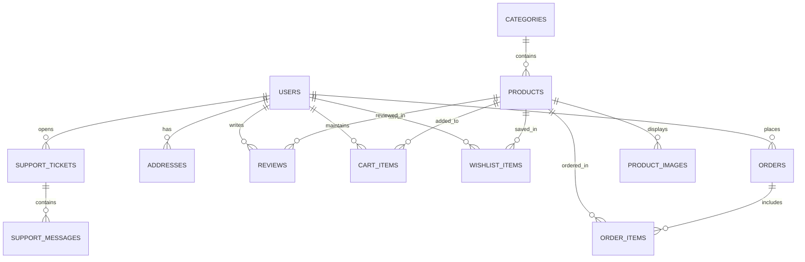

# SecondLife Relational Database Schema & Entities

The SecondLife database is designed with standard ANSI SQL compliance, providing seamless zero-configuration execution via SQLite in local development and production readiness on PostgreSQL.

## Entity Relationship Summary

## Tables & Primary Keys

1. `users` (`id` TEXT PRIMARY KEY)
   - `email`, `password_hash`, `first_name`, `last_name`, `role`, `phone`, `avatar_url`, `is_email_verified`, `is_active`, `created_at`, `updated_at`

2. `categories` (`id` TEXT PRIMARY KEY)
   - `name`, `slug` (UNIQUE), `description`, `image_url`, `icon_name`, `parent_id`, `created_at`

3. `products` (`id` TEXT PRIMARY KEY)
   - `title`, `slug` (UNIQUE), `short_description`, `description`, `price`, `original_retail_price`, `category_id`, `condition`, `stock_quantity`, `sku` (UNIQUE), `is_featured`, `is_archived`, `rebuild_info_json`, `specs_json`, `average_rating`, `review_count`, `created_at`, `updated_at`

4. `product_images` (`id` TEXT PRIMARY KEY)
   - `product_id`, `url`, `alt`, `is_primary`, `sort_order`

5. `addresses` (`id` TEXT PRIMARY KEY)
   - `user_id`, `recipient_name`, `street_address1`, `street_address2`, `city`, `state_or_province`, `postal_code`, `country`, `phone`, `is_default`, `created_at`

6. `orders` (`id` TEXT PRIMARY KEY)
   - `order_number` (UNIQUE), `user_id`, `status`, `shipping_address_json`, `subtotal`, `shipping_fee`, `discount`, `tax`, `total_amount`, `total_ewaste_diverted_kg`, `total_co2_saved_kg`, `payment_method`, `payment_status`, `payment_id`, `tracking_number`, `carrier`, `notes`, `created_at`, `updated_at`

7. `order_items` (`id` TEXT PRIMARY KEY)
   - `order_id`, `product_id`, `product_title`, `product_image`, `unit_price`, `quantity`, `total_price`, `condition`, `rebuild_notes`

8. `cart_items` (`id` TEXT PRIMARY KEY)
   - `user_id`, `product_id`, `quantity`, `selected_specs_json`, `created_at`, `updated_at`

9. `wishlist_items` (`id` TEXT PRIMARY KEY)
   - `user_id`, `product_id`, `created_at` (UNIQUE `user_id`, `product_id`)

10. `reviews` (`id` TEXT PRIMARY KEY)
    - `product_id`, `user_id`, `rating`, `title`, `comment`, `is_verified_purchase`, `is_approved`, `created_at`, `updated_at`

11. `support_tickets` (`id` TEXT PRIMARY KEY)
    - `ticket_number` (UNIQUE), `user_id`, `order_id`, `subject`, `category`, `priority`, `status`, `created_at`, `updated_at`

12. `support_messages` (`id` TEXT PRIMARY KEY)
    - `ticket_id`, `sender_id`, `sender_role`, `sender_name`, `message`, `created_at`

13. `audit_logs` (`id` TEXT PRIMARY KEY)
    - `user_id`, `user_name`, `user_role`, `action`, `entity_type`, `entity_id`, `details_json`, `ip_address`, `created_at`
